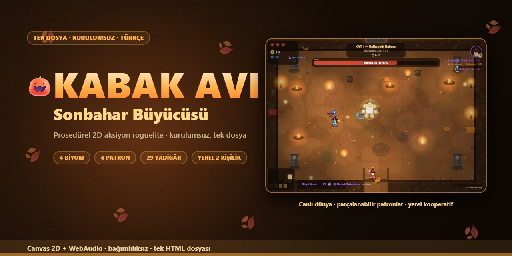
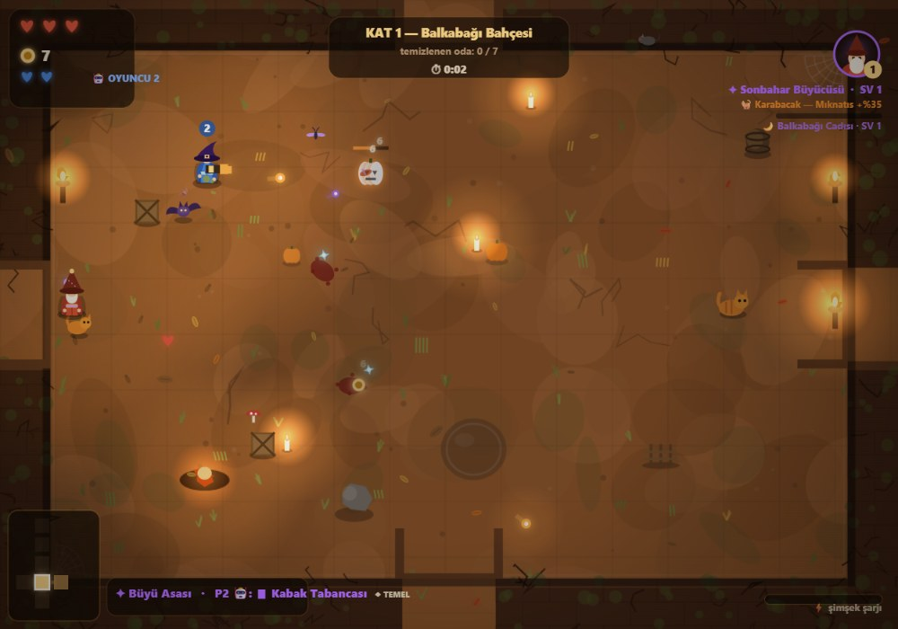
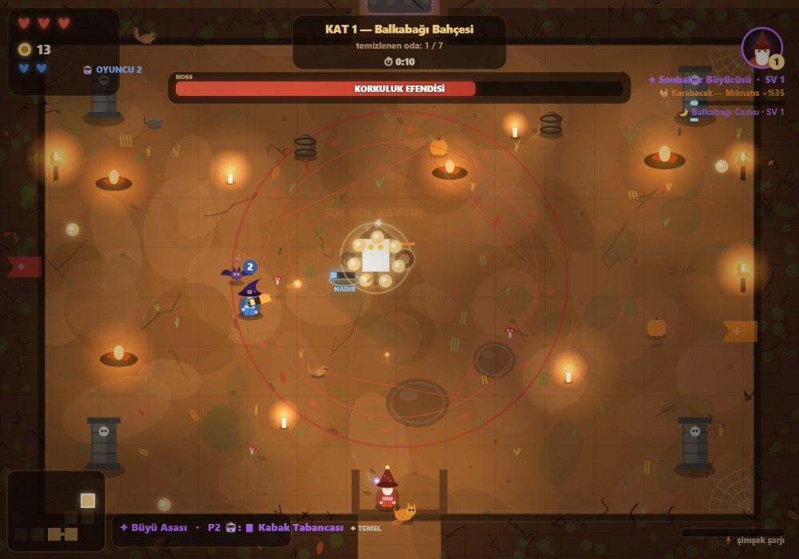
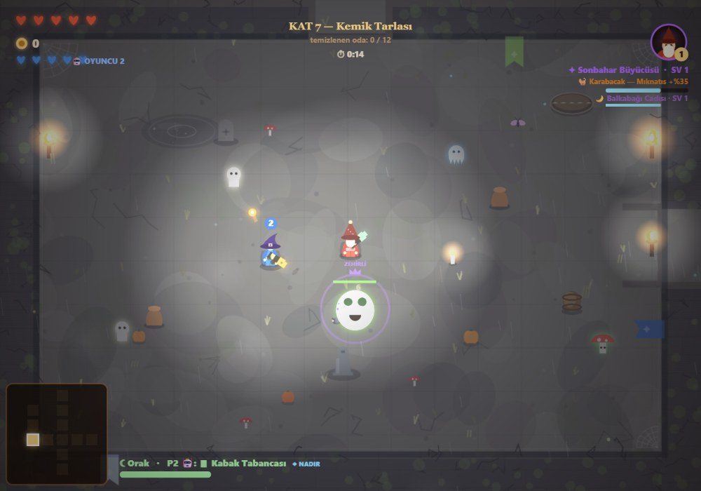
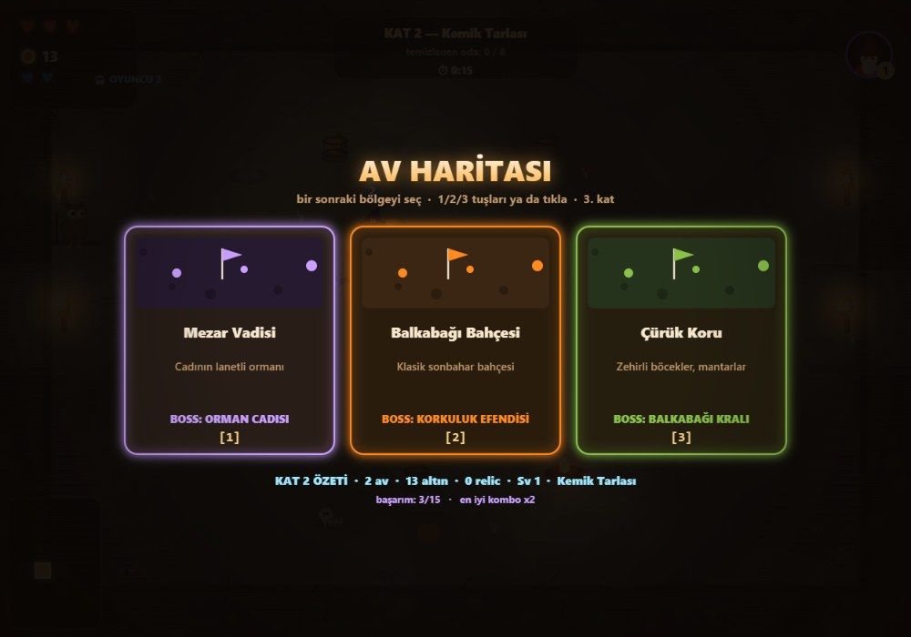

<div align="center">



# 🎃 KABAK AVI — Sonbahar Büyücüsü

**Tek dosyalık, prosedürel sonbahar temalı 2D aksiyon roguelite.**
Tarayıcıda çalışır; kurulum, bağımlılık ve internet bağlantısı istemez.

[](CHANGELOG.md)
[](LICENSE)
[](oyna.html)
[](#)

[**▶ Hemen Oyna**](https://saklabann.github.io/kabak-avi/oyna.html) · [Ekranlar](#-ekran-görüntüleri) · [Kontroller](#%EF%B8%8F-kontroller) · [Hata Bildir](../../issues/new?template=bug_report.md) · [Öneri Ver](../../issues/new?template=feature_request.md)

</div>

---

## 📖 İçindekiler

- [Oyun nedir?](#-oyun-nedir)
- [Öne çıkanlar](#-öne-çıkanlar)
- [Ekran görüntüleri](#-ekran-görüntüleri)
- [Kontroller](#%EF%B8%8F-kontroller)
- [Nasıl oynanır](#-nasıl-oynanır)
- [Çalıştırma](#-çalıştırma)
- [Teknik mimari](#-teknik-mimari)
- [Sürüm geçmişi](#-sürüm-geçmişi)
- [Yol haritası](#-yol-haritası)
- [Katkı](#-katkı)
- [Lisans](#-lisans)

---

## 🎮 Oyun nedir?

Sonbahar diyarı çürümeye teslim olmuş; sen bir sonbahar büyücüsüsün. Kat kat inen prosedürel zindanlarda
odalar kilitlenir, düşmanlar fışkırır, patronlar uyanır. Her şey oyunun içinden üretilir: zeminler, duvarlar,
dekorlar, canavarlar, müzik ve ses efektleri.

**Voidigo'dan ilham alan beş sistem** oyunun omurgasıdır:

| Sistem | Ne yapar? |
|:--|:--|
| 🔫 **Düşür · Değiştir · Fırlat** | Düşmanlar silah bırakır; mühimmat biter, silah kırılır. Yerden al, kuşan ya da düşmana fırlat. |
| 🦴 **Parçalanabilir patronlar** | Kollar, boynuzlar, kaburgalar, büyü küreleri ayrı ayrı kırılır; kırılan parça patronu zayıflatır. |
| 🟣 **Yolsuzluk zinciri** | Vuruşlar yolsuzluk yükler; dolan düşman patlar ve zincirleme çevreye yayılır. |
| 🗺️ **Av haritası** | Her kat sonunda 3 bölge arasından seçim; zorluk ve ödüller bölgeye göre değişir. |
| 👥 **Yerel 2 kişilik** | Aynı klavyede iki oyuncu; 2. oyuncuyu yapay zekâya bırak ya da ok tuşlarıyla devral. |

---

## ✨ Öne çıkanlar

|  |  |
|:--|:--|
| 🗺️ **4 biyom · 4 patron** | Balkabağı Bahçesi, Çürük Koru, Kemik Tarlası, Mezar Vadisi |
| 💎 **29 yadigâr (relic)** | Her sefer başka kombinasyonlar |
| 🙏 **10 kalıcı kutsama** | Ölsen bile harcanan ruhlar, altın/tecrübe çarpanları, zorluk seçenekleri |
| 🧙 **5 sınıf + 4 evcil hayvan** | Büyücü, Karakabak, Cüce Demirci, Cadı Kızı, Çılgın Palyaço + kedi, kuzgun, kurbağa, yavru kabak |
| 🔫 **7 silah** | Mühimmat, kırılma, nadirlik seviyeleri ve fırlatma mekaniği |
| 👑 **Elit rütbeler** | ZIRHLI · HIZLI · ZEHİRLİ · KADİM |
| 🧱 **Gizli odalar** | Çatlak duvarı kır, haritada görünmeyen hazineyi bul |
| 🏆 **15 başarım · kombo sayacı · sefer özeti** | İlerleme kaydedilir (`localStorage`) |
| 🦉 **Bilge Baykuş** | Her katın başında ipucu veren rehber |
| 🌧️ **Canlı dünya** | Yaprak burgaçları, mum dumanı, gece ateşböcekleri, kuş sürüleri, şimşek + gök gürültüsü, yağmur sesi |
| 🎨 **Yenilenen arayüz** | Cam paneller, amber gradyanlar ve yuvarlatılmış kartlar; üst-ortada boss can barı |
| 📱 **Dokunmatik destek** | Telefonda sanal joystick ve aksiyon düğmeleri |
| 👥 **Yerel kooperatif** | İki oyuncu da ölünce sefer biter; 2. oyuncu botu akıllıdır |

---

## 📸 Ekran görüntüleri

|  |  |
|:--:|:--:|
|  <br> **Balkabağı Bahçesi** · 2 oyuncu, elit avcılar |  <br> **Korkuluk Efendisi** · kırılabilir parçalar |
|  <br> **Kemik Tarlası** · gece, yağmur, şimşek |  <br> **Av Haritası** · bölge seçimi |

---

## ⌨️ Kontroller

<table>
<tr><th>1. Oyuncu</th><th>2. Oyuncu</th></tr>
<tr><td>

| Tuş | İşlev |
|:--|:--|
| `W A S D` | Hareket |
| `Fare` | Nişan · **sol tık** ateş · **sağ tık** ışın |
| `Boşluk` | Dash (kaçış / çarpma hasarı) |
| `E` | Etkileşim (sandık, tüccar, baykuş) |
| `F` / `Q` | Silah değiştir / fırlat |
| `P` | Duraklat |
| `M` | Sesi kapat/aç |

</td><td>

| Tuş | İşlev |
|:--|:--|
| `↑ ↓ ← →` | Hareket ve nişan |
| `,` | Dash |
| `.` / `/` | Silah değiştir / fırlat |
| `🤖` | Bot modu (menüden aç/kapa) |

</td></tr>
</table>

> 📱 **Dokunmatik:** sol yarı joystick · sağ düğmeler: dash, ışın, kullan, silah değiştir, fırlat.

---

## 🧠 Nasıl oynanır

1. **Odaya gir, temizle.** Kapılar kilitlenir; düşmanlar bitince ödüller düşer.
2. **Mini haritayı kullan.** Hazine ve tüccar odalarını bul; çatlak duvarları kır.
3. **Kat sonunda yadigâr seç.** 3 seçenekten birini al.
4. **Av haritasından bölge seç.** Her bölgenin zorluğu ve ödülü farklı.
5. **Patronu devir.** En uzak odada bekler; parçalarını kırmayı unutma.
6. **Öldüysen ruhlar seninle.** Menüdeki kutsamalarla daha güçlü dön.

---

## 🚀 Çalıştırma

**En kolay yol:** `oyna.html` dosyasına çift tıkla. Bitti.

Depoyu klonlayarak:

```bash
git clone https://github.com/Saklabann/kabak-avi.git
cd kabak-avi
# oyna.html dosyasını tarayıcıda aç
```

Yerel sunucu tercih edersen:

```bash
python -m http.server 8777
# ardından: http://127.0.0.1:8777/oyna.html
```

> 💡 Oyun çevrimdışı çalışır. Kayıtlar tarayıcının `localStorage` alanında tutulur (`kabakAvi_v1`).

---

## 🛠️ Teknik mimari

| Katman | Uygulama |
|:--|:--|
| **Çizim** | Canvas 2D · prosedürel oda üretimi (`genFloor`, `genDecor`, `renderRoomBg`), ön-render edilmiş zemin/duvar katmanları |
| **Denetim** | Sabit adımlı oyun döngüsü (60 FPS hedefi), delta-time tabanlı fizik, çarpışma ızgarası |
| **Ses** | WebAudio ile sentezlenen müzik (doğal minör döngü) ve efektler; rüzgâr/yağmur döngü katmanları |
| **Yapay zekâ** | 2. oyuncu botu: hedef önceliği, menzile göre konumlanma, mermiden kaçınma, otomatik dash |
| **Durum** | `STATE` makinesi (MENU/PLAY/RELIC/DEAD/SHOP/PAUSE/MAP), `localStorage` kaydı + göç (migration) |
| **Boyut** | Tek `oyna.html` dosyası, ~250 KB, harici istek yok |

```
kabak-avi/
├─ index.html                 # tanıtım sayfası (GitHub Pages)
├─ oyna.html                  # OYUN — tek dosya, bağımlılıksız
├─ assets/
│  ├─ social-preview.jpg      # repo sosyal önizleme görseli
│  └─ screens/                # ekran görüntüleri
├─ CHANGELOG.md
├─ CONTRIBUTING.md
├─ LICENSE
└─ README.md
```

---

## 📜 Sürüm geçmişi

Ayrıntılar için [CHANGELOG.md](CHANGELOG.md).

| Sürüm | Ad | Özet |
|:--|:--|:--|
| **v2.0.0** | **Sezon 2 · Canlı Dünya** | Elit rütbeler, gizli odalar, yeni düşmanlar (hayalet, mantar), canlı ortam (şimşek, kuşlar, ateşböcekleri, Bilge Baykuş, sincaplar), ortam sesleri, ayarlar ve 15 başarım |
| v1.0.0 | Sezon 1 | Temel roguelite döngüsü, 4 biyom + 4 patron, yadigârlar, Voidigo sistemleri, yerel kooperatif |

---

## 🗺️ Yol haritası

- [x] **Sezon 1** — temel döngü, biyomlar, patronlar, yadigârlar
- [x] **Sezon 2** — elit rütbeler, gizli odalar, canlı dünya, ortam sesleri
- [ ] **Sezon 3** — günlük seferler, liderlik tablosu, yeni biyom *(Sisli Liman?)*
- [ ] Oyun kolu desteği
- [ ] Çevrimdışı PWA kurulumu
- [ ] İngilizce dil desteği

---

## 🤝 Katkı

Katkılar sevilir! Başlamadan önce [CONTRIBUTING.md](CONTRIBUTING.md) dosyasına göz at.
Hata bildirimleri için [issue şablonu](../../issues/new?template=bug_report.md), öneriler için
[öneri şablonu](../../issues/new?template=feature_request.md) hazır.

---

## 📄 Lisans

[MIT](LICENSE) © 2026 KABAK AVI

> İlham: **Voidigo** (Pretty Beast Games). Bu proje bağımsız bir hayran çalışmasıdır —
> hiçbir özgün varlık (görsel, ses, kod) kullanılmamıştır; her şey sıfırdan üretilmiştir.
